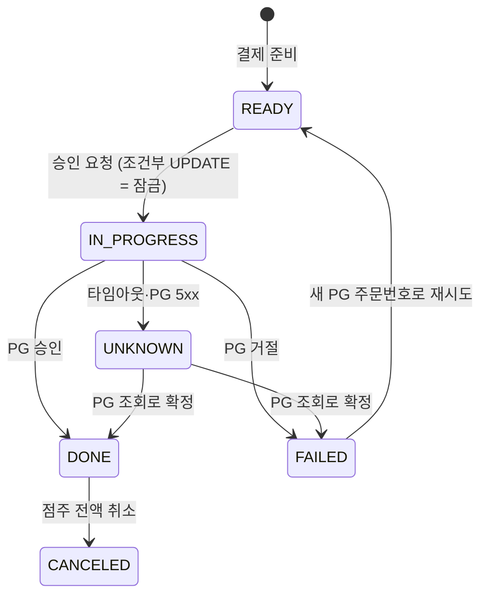
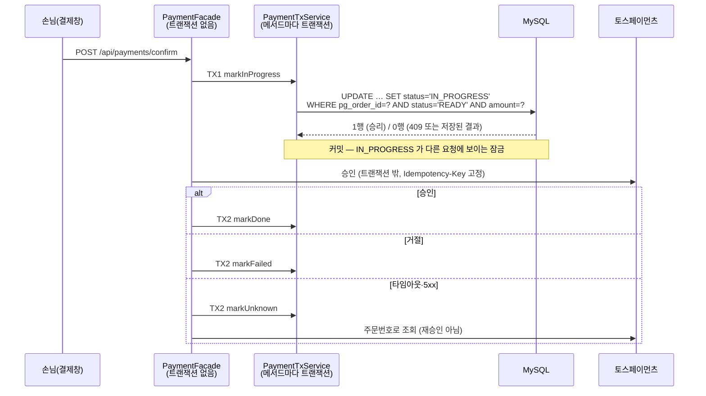

# Order-Free · 테이블오더 백엔드

매장 테이블에서 손님이 QR로 메뉴를 보고 직접 주문·결제하는 테이블오더 서비스의 백엔드입니다.
**2025 한이음 드림업** 산학연계 프로젝트로 진행했으며, **사업대상**에 선정됐습니다.

> 팀 프로젝트([hanium-table-order/Order-Free-Backend](https://github.com/hanium-table-order/Order-Free-Backend)) 종료 후,
> 이 포크에서 개인적으로 보안 정비와 **결제 모듈(중복 결제 방지)** 을 추가 개발했습니다.

## 주요 기능

| 영역 | 내용 |
| --- | --- |
| 손님 | 테이블별 메뉴 조회(다국어), 장바구니, 주문, 주문 내역, 직원 호출, 결제 |
| 점주 | 매장·카테고리·메뉴·재고 관리, 주문 상태 변경, 테이블·평면도, 매출 집계, QR 생성, 결제 취소 |
| 주문 | 상태 흐름 `ORDERED → PREPARING → SERVED → COMPLETED`, `ORDERED/PREPARING → CANCELLED` |
| 재고 | 품절·재고 부족 메뉴는 담기·주문 차단, 주문 시 원자적 차감, 취소 시 복원 |
| 결제 | 토스페이먼츠 연동 — 준비·승인·조회·취소·웹훅, **주문당 승인 최대 1회** 보장 |
| 실시간 | SSE로 메뉴판을 보고 있는 접속자 수 전송 |
| 인증 | 손님 API는 공개, 점주 API는 JWT(`role=OWNER`) + 토큰의 `storeIds`로 **매장 소유권** 검사 |

## 기술 스택

`Java 17` `Spring Boot 3.3` `Spring Data JPA` `Spring Security (JWT)` `MySQL 8` `Flyway` `Redis (QR 캐시)` `토스페이먼츠`
<br>테스트: `JUnit 5` `Testcontainers (MySQL)` `WireMock` `MockMvc`

---

## 결제 모듈 — 중복 결제 방지

"같은 주문이 두 번 승인되지 않는다"를 **트랜잭션 경계 분리**와 **조건부 상태 전이**로 보장하고, 실제 MySQL에서 동시성 테스트로 증명했습니다.

### 결제 상태

주문 상태(조리·서빙 흐름)와 결제 상태를 분리했습니다. 주문 상세의 결제 상태(`UNPAID / PAID / REFUNDED`)는 결제 기록에서 계산합니다.



`UNKNOWN`에서 `IN_PROGRESS`로 돌아가는 길은 없습니다. 결과를 모르는 결제는 **다시 승인하지 않고 조회로만** 확정합니다.

### 승인 흐름과 트랜잭션 경계



PG 호출을 하나의 `@Transactional` 안에 두지 않은 이유는 두 가지입니다.

- **PG는 승인했는데 이후 DB 예외로 롤백되면** DB에는 결제 흔적이 없습니다. 손님이 다시 결제하면 이중 결제가 됩니다. DB 롤백은 외부 승인을 되돌리지 못합니다.
- PG 응답을 기다리는 동안 **DB 커넥션과 행 락을 붙잡아** 커넥션 풀이 마릅니다.

분리한 구조에서는 PG 승인 후 TX2가 실패해도 결제가 `IN_PROGRESS`로 남고, 복구 배치가 PG 조회로 `DONE`을 확정합니다.
같은 클래스 안의 `@Transactional` 호출은 프록시를 거치지 않으므로 `PaymentFacade`와 `PaymentTxService`를 나눴습니다.

### 방어선

| 상황 | 방어 |
| --- | --- |
| 동시 승인 요청 | `READY → IN_PROGRESS` 조건부 UPDATE — MySQL이 같은 행 UPDATE를 직렬화해 하나만 1행을 얻음 |
| 이미 승인된 결제에 같은 요청 | 저장된 결과 반환, PG 재호출 없음 |
| 같은 주문에 결제 행 2개 | `order_id` UNIQUE, 동시 준비 요청은 UNIQUE 위반을 잡아 기존 결제 반환 |
| 같은 PG 승인이 두 번 기록 | `payment_key` UNIQUE |
| 클라이언트 금액 조작 | 서버 금액과 비교(400), 조건부 UPDATE에도 금액 포함 |
| 승인 응답 타임아웃 | `UNKNOWN` → PG 주문번호 조회로만 확정, 재승인 금지 |
| PG 측 중복 | 승인 `Idempotency-Key: confirm-{pgOrderId}`, 취소 `cancel-{paymentKey}` |
| 웹훅 중복 수신 | 이벤트 키 `INSERT IGNORE` + 상태 변경을 한 트랜잭션으로 |
| 웹훅 위조 | 본문은 중복 판별에만 쓰고, 실제 상태는 PG 조회로 확인 |
| 멈춘 결제 | 1분마다 복구 배치: 1분 넘게 미확정인 결제를 조회로 확정, PG에 기록이 없으면 5분 뒤 `FAILED` |
| 버튼 연타 | 결제창 버튼 비활성화 (UX 보조일 뿐, 서버 방어로 치지 않음) |

Redis 분산 락은 쓰지 않았습니다. 단일 MySQL에서는 조건부 UPDATE와 UNIQUE 제약으로 충분하고, 락 만료·장애 시나리오만 늘어납니다.

### 검증 (실제 MySQL + WireMock)

[`PaymentApprovalMySqlTest`](src/test/java/com/example/tableorder/service/payment/PaymentApprovalMySqlTest.java),
[`PaymentWebhookCancelMySqlTest`](src/test/java/com/example/tableorder/service/payment/PaymentWebhookCancelMySqlTest.java)

| ID | 시나리오 | 결과 |
| --- | --- | --- |
| T-1 | 같은 승인 요청 100건 동시 발사 | **PG 승인 호출 1건**, DONE 1건, 409 99건 |
| T-2 | 금액을 1원 바꿔 승인 요청 | 400, PG 호출 0건 |
| T-3 | PG 응답이 타임아웃 | `UNKNOWN` → 조회로 `DONE`, 승인 추가 호출 0건 |
| T-4 | PG 승인 후 TX2 강제 예외 | `IN_PROGRESS`로 남고 복구로 `DONE` |
| T-5 | 같은 웹훅 3건 동시 수신 | 상태 변경(UPDATE) 1회 |
| T-6 | DONE 결제에 같은 승인 재요청 | 저장된 결과 반환, PG 호출 0건 |
| T-7 | 취소 2회 | PG 취소 1회, 동시 취소는 같은 멱등키 |
| T-8 | **역방향 실험**: PG 호출을 한 트랜잭션 안에 둔 잘못된 구현 | "PG 승인됨 + DB 미결제" 불일치 재현 → T-4와 대비 |

```
[T-1] 동시 요청 100건 → PG 승인 호출 1건, DONE 응답 1건, 409 99건
```

### 결제 API

| 메서드 · 경로 | 호출자 | 응답 |
| --- | --- | --- |
| `POST /api/stores/{storeId}/tables/{tableId}/orders/{orderId}/payments` | 손님 | 201 새 결제 · 200 기존 결제 |
| `POST /api/payments/confirm` | 손님(결제창 successUrl) | 200 DONE · 202 확정 대기 · 400 금액 불일치/거절 · 409 처리 중 |
| `GET /api/payments/{pgOrderId}` | 손님 | 현재 상태 (추측 불가능한 PG 주문번호로만 조회) |
| `POST /api/admin/payments/{paymentId}/cancel` | 점주 | 200 CANCELED · 409 DONE 아님 · 503 결과 미확인(재시도 안전) |
| `POST /api/payments/webhook` | 토스페이먼츠 | 200 (중복 포함) · 503 PG 조회 실패 시 재전송 유도 |

결제 준비 API는 PRD의 `/api/orders/{orderId}/payments` 대신 손님 경로(매장·테이블) 아래에 두어, 그 테이블의 주문만 결제할 수 있게 했습니다.

---

## 실행

### 준비물

- JDK 17
- MySQL 8 (스키마는 앱 시작 시 Flyway가 만든다)
- Redis (QR 캐시용, 선택)
- Docker (테스트용)

### 설정

`application.yml`은 git에 넣지 않습니다. 예시를 복사해서 쓰고, 값은 프로젝트 루트의 `.env`에 둡니다.

```bash
cp src/main/resources/application.yml.example src/main/resources/application.yml
```

```dotenv
DB_HOST=localhost
DB_PORT=3306
DB_NAME=tableorder
DB_USER=...
DB_PASS=...
JWT_SECRET=32바이트 이상의 임의 문자열   # 짧거나 없으면 앱이 시작되지 않는다
TOSS_SECRET_KEY=test_sk_...           # 토스 개발자센터 테스트 키
TOSS_CLIENT_KEY=test_ck_...
```

```bash
./gradlew bootRun
```

- API 문서: `http://localhost:8080/swagger-ui.html`
- 결제 테스트 페이지: `http://localhost:8080/payment-test.html` (테스트 키로 결제창 → 승인까지)
- 점주 API 토큰: 테스트 소스의 [`JwtTokens`](src/test/java/com/example/tableorder/support/JwtTokens.java)를 `JWT_SECRET` 환경변수와 함께 `<ownerId> <storeId...>` 인자로 실행

### 테스트

```bash
./gradlew test
```

Docker가 켜져 있어야 합니다. Testcontainers가 MySQL 8 컨테이너를 띄워 Flyway 마이그레이션, JPQL, MySQL 전용 쿼리, 행 락 동작까지 실제 DB에서 확인합니다. PG는 WireMock으로 대체합니다.

## 프로젝트 구조

```
src/main/java/com/example/tableorder
├── config/          보안(JWT·매장 소유권), SSE, 결제 설정
├── controller/      손님·점주 API
├── service/
│   ├── payment/     PaymentFacade, PaymentTxService, 복구 서비스·배치
│   │   └── pg/      토스페이먼츠 클라이언트 (타임아웃·멱등키·오류 분류)
│   └── ...          주문·재고·메뉴·매출 등
├── entity/          Order·OrderStatus, Payment·PaymentStatus 등
└── repository/
src/main/resources/db/migration   Flyway V1~V6
```

## 개발 메모

결제가 걸린 서비스라 주문·결제 상태를 분리하고 트랜잭션 경계를 명확히 하는 데 집중했습니다.
프로젝트 진행 중 **BC카드 현직자 멘토링**을 받아, 결제 흐름과 상태 관리 방식을 설계에 반영했습니다.
